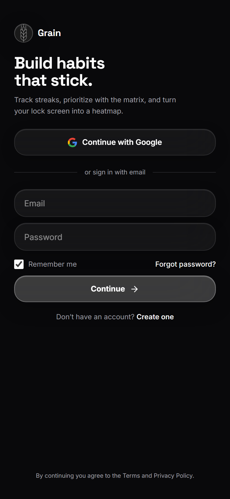
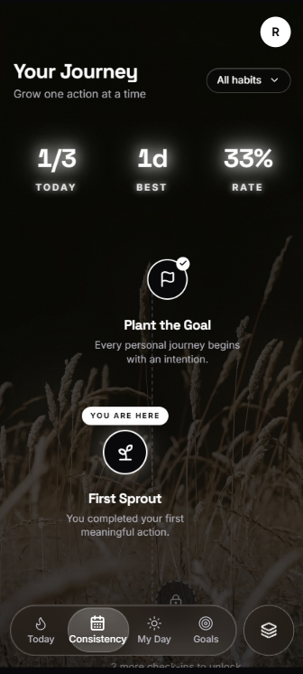
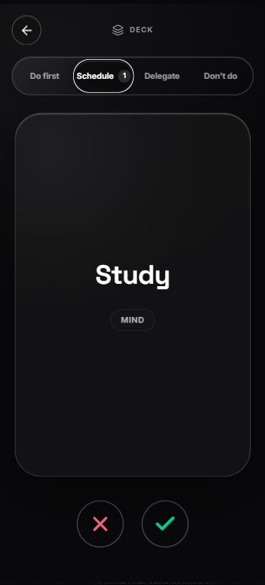
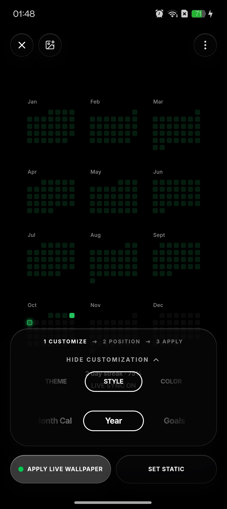

# Grain

A habit and goal tracker for building everyday discipline.

Website: [trygrain.vercel.app](https://trygrain.vercel.app/)

Download the latest Android build from [Releases](https://github.com/sharmaronit/grain/releases/latest).

| Today | Consistency | Deck | Live wallpaper |
|---|---|---|---|
|  |  |  |  |

## Repository

| Folder | Purpose |
| --- | --- |
| `src/` | React Android app source |
| `android/` | Capacitor Android project |
| `landing/` | Website source and runtime assets |
| `public/` | App runtime assets |
| `assets/` | Native app resources and reference images |
| `config/` | Local reference configuration files |
| `docs/` | Development, features, design, and release documentation |
| `scripts/` | Android build automation |
| `tests/` | App tests |
| `releases/android/grain.apk` | Local build output, ignored by Git (download from [Releases](https://github.com/sharmaronit/grain/releases/latest)) |
| `archive/` | Previous website implementation and capture tools |

Generated web builds go into `dist/app/` and `landing/dist/`. They are ignored by Git.

## Commands

```powershell
npm install
npm run dev
npm run build
npm test
npm run build:android
```

Website commands run from `landing/`: `npm run dev`, `npm run build`, and `npm run lint`.

## Documentation

- [Development and Android setup](docs/development.md)
- [Website setup](docs/landing.md)
- [Features](docs/features.md)
- [Liquid glass design and production CSS](docs/design/liquid-glass.md)
- [APK and GitHub release workflow](docs/releases.md)
- [Archived files](docs/archive.md)

Copyright © 2026 Ronit Sharma. See [LICENSE](LICENSE).
